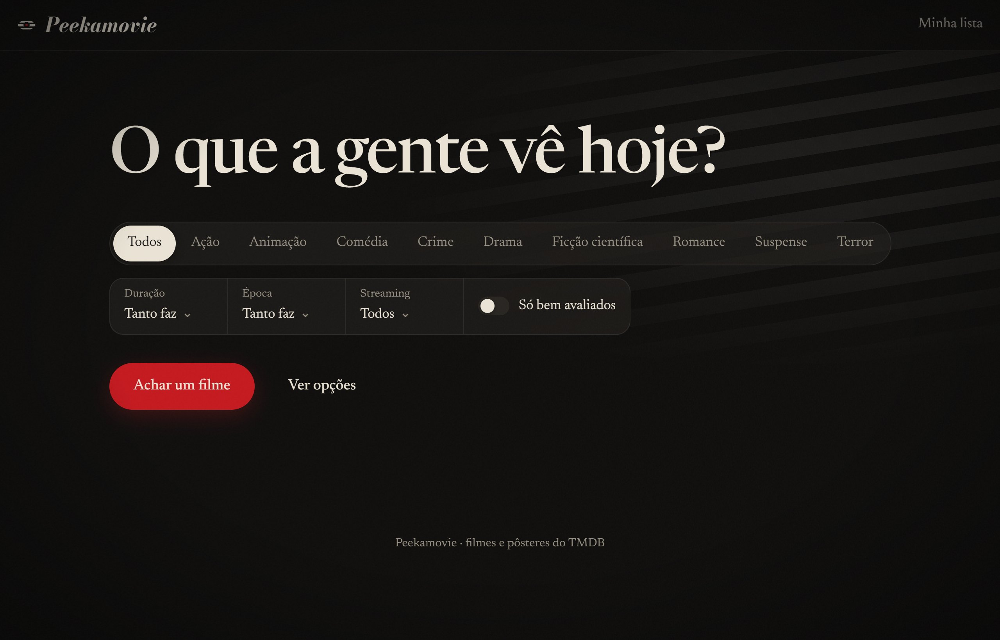
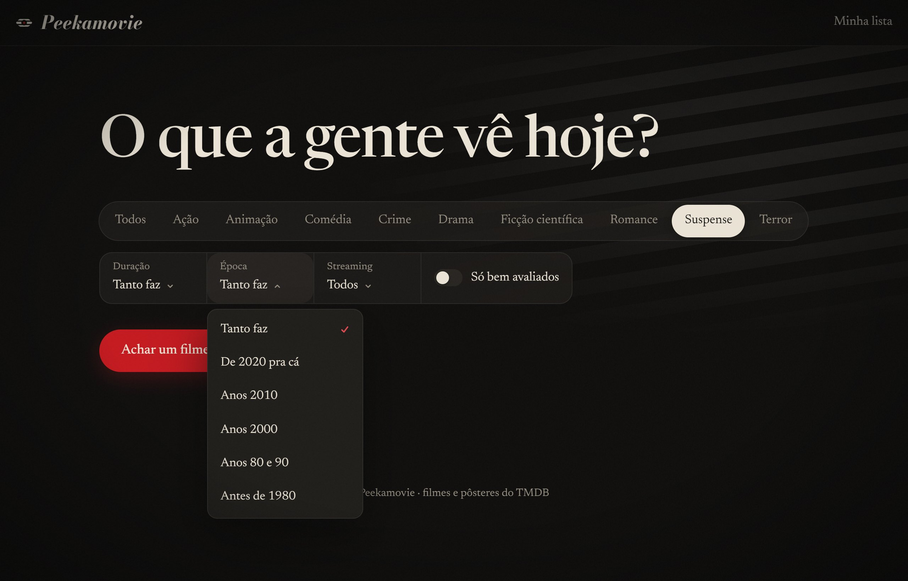
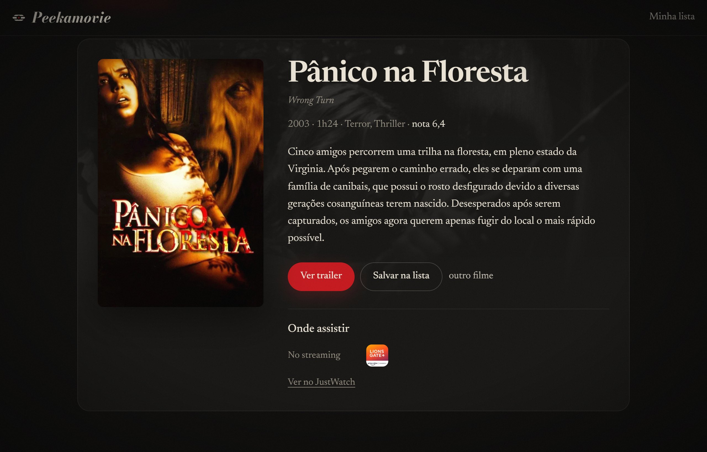
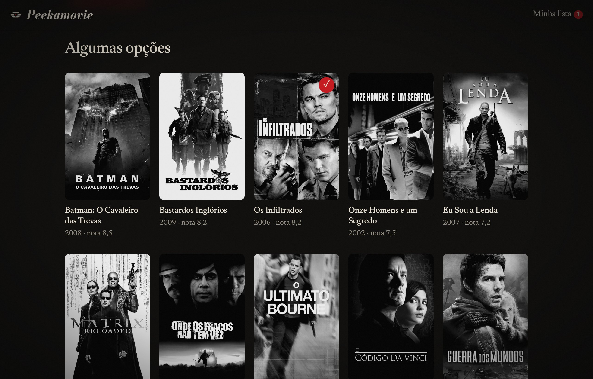
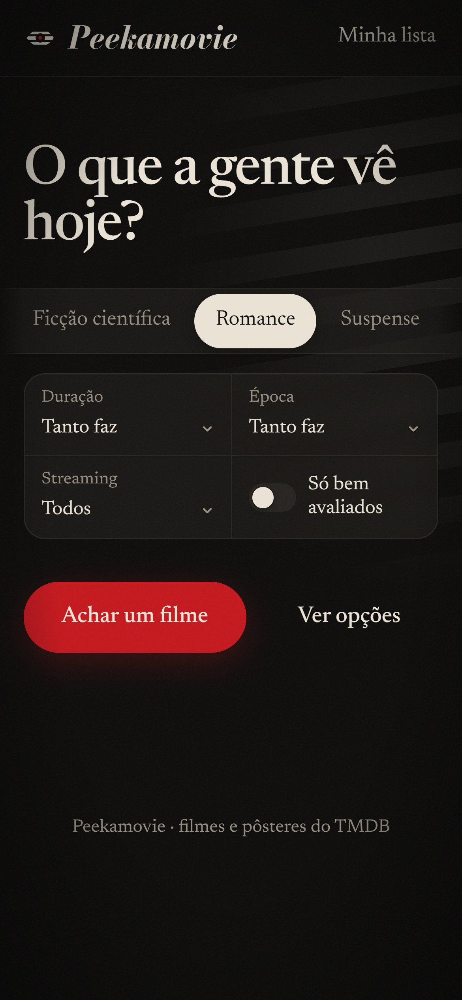
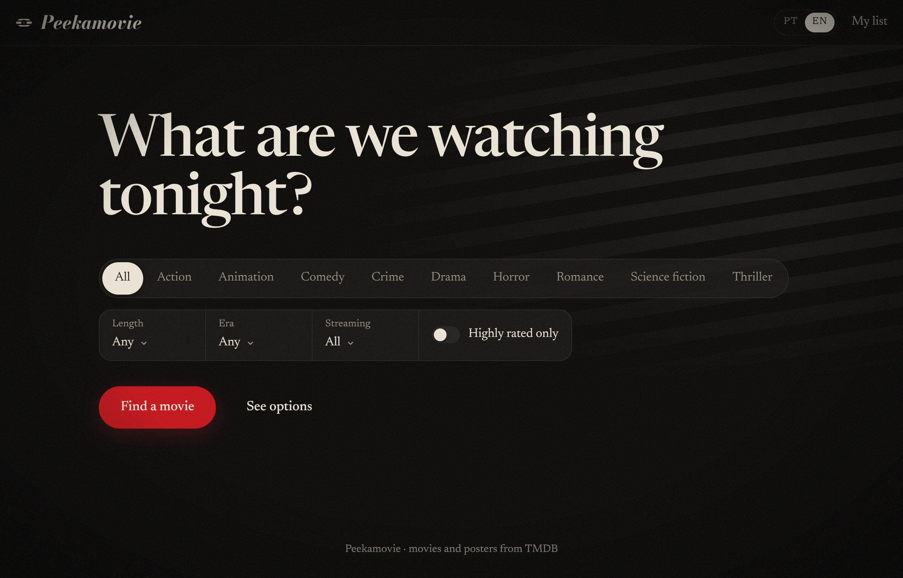
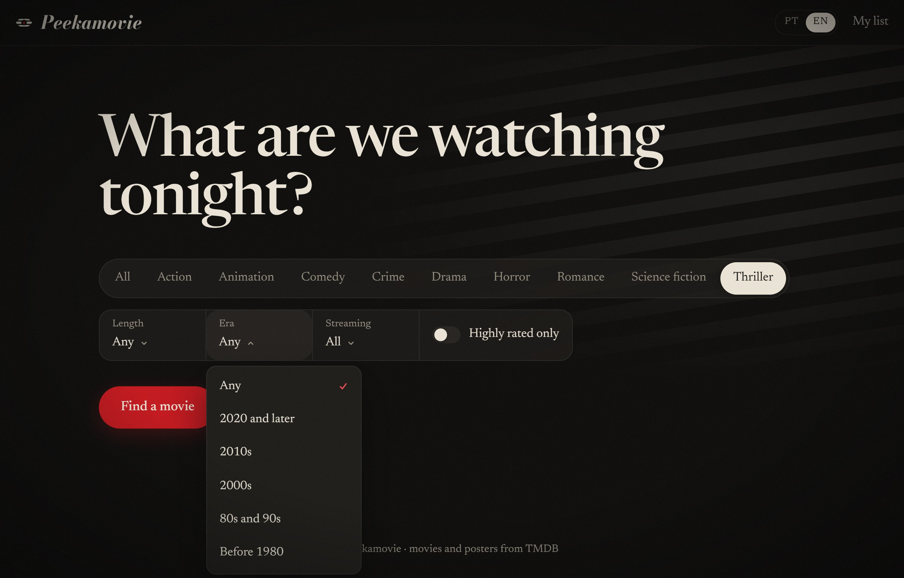
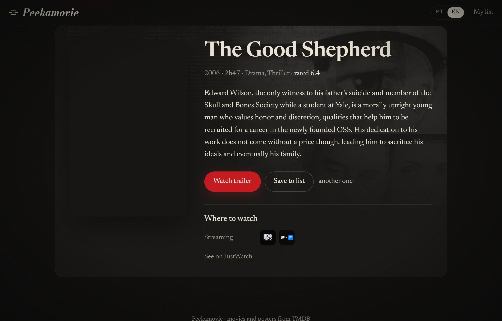
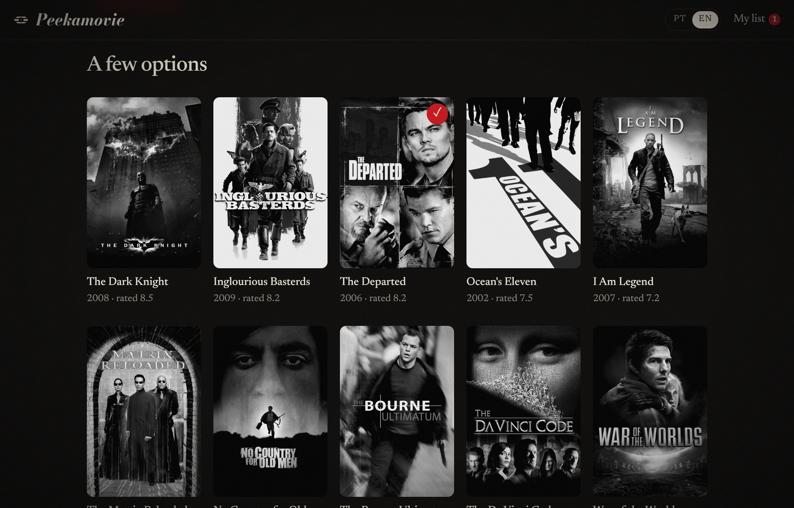
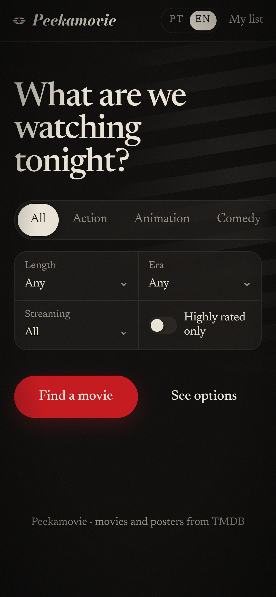

<h1 align="center"> Peekamovie</h1>

<em>O que a gente vê hoje? · What are we watching tonight?</em>

<a href="https://peek-a-movie.vercel.app"><strong>peek-a-movie.vercel.app</strong></a>

 

## Português

  Escolhe o gênero, ajusta duração, época e os streamings que você assina, e ele acha um filme pra hoje. 
  Não curtiu? Pede outro.

 

 

Sinopse, trailer e onde assistir no Brasil. O pôster revela a cor aos poucos, como uma foto.

 

Prefere escolher com calma? Tem a lista de opções, e o que te interessar vai pra sua lista.

 

Funciona no celular também, em português e em inglês.

 

---

 

## English

  Pick a genre, set the length, the era and the streaming services you have, and it finds you a movie for tonight. 
  Not feeling it? Ask for another one.

 

 

Synopsis, trailer and where to watch it. The poster fades into color, like a photo being developed.

 

Rather take your time? Browse a list of options and save the ones you like to your list.

 

Works on your phone too, in English and Portuguese.

---

  <strong>Peekamovie</strong> · © 2026 
  Filmes e pôsteres / Movies and posters: <a href="https://www.themoviedb.org">TMDB</a>. Este produto usa a API do TMDB, mas não é endossado nem certificado pelo TMDB. This product uses the TMDB API but is not endorsed or certified by TMDB.

